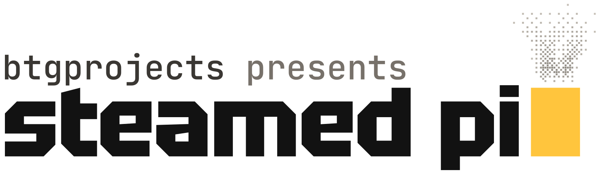

<p align="center">
  <picture>
    <source media="(prefers-color-scheme: dark)" srcset="assets/brand/logo-compact/steamed-pi-compact-dark-bg-1600w.png">
    
  </picture>
</p>

# Steamed Pi

**Turn a Raspberry Pi 5 into a Steam-Deck-style game console.**
It boots straight into Steam Big Picture, has a Home-button menu, switches to a normal Ubuntu desktop with one click, and gets out of the way of your games.


## What you get
- **Gaming Mode**: a minimal compositor running Valve's native ARM64 Steam client in Big Picture. Boots in about 23 seconds, uses about 1 GB of RAM for Steam itself.
- **Home menu** (controller Home button or Super+Esc): pauses the running game, then Resume / Steam / Settings / Console info / Switch to Desktop / Restart Steam / Reboot / Power off.
- **Settings page** in that menu: boot mode, screen resolution, startup movie, start-up notices, what to do if Steam keeps failing, SSH and FTP switches, which address to show first, the console's network name, desktop look, and a new dashboard PIN.
- **Desktop Mode**: your normal Ubuntu desktop, untouched, one click away (and a "Return to Gaming Mode" icon in its dock).
- **Web dashboard** on your network: status, SSH/FTP switches, rename the console, restart Steam, reboot. Reachable only from your home network and protected by a PIN.
- **Emulation** (optional): ES-DE front end, RetroArch with 11 cores, Dolphin, set up for a controller.
- **Windows games** via Proton Experimental (ARM64), pre-tuned for the Pi's GPU, plus a tool that predicts which games in *your* library should run.
- **One theme** across boot splash, Steam startup movie, login screen, desktop, terminal, menus and dashboard. Swap the art to make it yours ([docs/CUSTOMIZING.md](docs/CUSTOMIZING.md)).

## Install (mostly downloading, so it depends on your connection)
You need a **Raspberry Pi 5 (8 GB recommended)** running **Ubuntu Desktop for the Raspberry Pi**, signed in, with internet access.

```bash
git clone https://github.com/bgrimes-me/steamed-pi.git
cd steamed-pi
./install.sh
sudo reboot
```

When the console boots into Steam, **sign in to Steam**. That is the only manual step: Steamed Pi finishes the rest by itself.
Details, options and troubleshooting: [docs/INSTALL.md](docs/INSTALL.md). Undo everything with `./uninstall.sh`.

## Honest limits
- The Pi 5's GPU cannot run DirectX 11/12 games through DXVK, which rules out most modern Windows games and almost every Unity game. Older 2D and indie games are the sweet spot. See [docs/COMPATIBILITY.md](docs/COMPATIBILITY.md).
- Built and tested on a Raspberry Pi 5 (8 GB) with Ubuntu 26.10: the installer has been run for real on the author's own Pi, with the whole system rebooted and used afterwards. **A from-scratch install on a freshly flashed card has not been done yet**, so expect rough edges and please report them. Other Pi models and other Ubuntu releases are untested; the installer warns before it proceeds.
- Steam, ES-DE, RetroArch and Proton are downloaded from their own publishers at install time. None of them is included in this repository.

## Documentation
| | |
|---|---|
| [docs/INSTALL.md](docs/INSTALL.md) | requirements, options, what the installer changes, undo |
| [docs/CUSTOMIZING.md](docs/CUSTOMIZING.md) | replace the wallpaper, logo, startup movie, boot splash, colors |
| [docs/COMPATIBILITY.md](docs/COMPATIBILITY.md) | what runs, what doesn't, and the tool that checks your library |
| [docs/ARCHITECTURE.md](docs/ARCHITECTURE.md) | how it works inside |
| [docs/TROUBLESHOOTING.md](docs/TROUBLESHOOTING.md) | recovering, logs, common problems |
| [docs/IMAGE.md](docs/IMAGE.md) | the "flash and go" image (experimental) |

## License
Code: MIT ([LICENSE](LICENSE)). Third-party software and trademarks: see [NOTICE.md](NOTICE.md).
